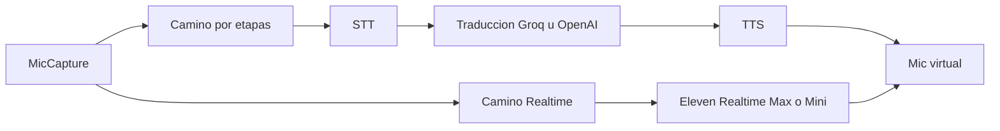

# Probar STT, voz y Realtime Max

Los defaults no cambian: Groq Whisper, traducción Groq y TTS ElevenLabs `eleven_multilingual_v2`. Lo nuevo es poder elegir el resto y oír la diferencia en la misma reunión.

Hay dos caminos. El primero es el pipeline por turnos de hoy. El segundo sustituye STT + traducción + TTS por un solo agente de voz.

## Camino por etapas

**STT** (misma interfaz `transcribeTurn`, el turno lo sigue cerrando el VAD):

- Deepgram nuevo: [`pipeline/src/stt/deepgram.mjs`](pipeline/src/stt/deepgram.mjs), `POST https://api.deepgram.com/v1/listen`. Modelos `nova-3` (idioma de origen, recomendado) y `nova-3-multi` (`language=multi`). Key nueva `deepgram`.
- Scribe v2 Realtime: cliente WebSocket sobre el turno ya cerrado (`wss://api.elevenlabs.io/v1/speech-to-text/realtime`, `model_id=scribe_v2_realtime`, `commit_strategy=manual`). Una conexión por sesión; cada turno manda el PCM, hace commit y devuelve el texto final. Después sigue la traducción y el TTS de siempre. Hoy [`sttModelFits`](app/engine/settings-store.mjs) rechaza cualquier id con `realtime`; se admite solo `scribe_v2_realtime`.
- Scribe batch (`scribe_v2`, `scribe_v1`), Groq y OpenAI se quedan como están.

**Traducción:** sigue solo Groq u OpenAI. No se toca.

**Voz:** selector nuevo `ttsProvider`.

- `elevenlabs` (default): clon IVC/PVC. Completar capacidades de `eleven_v4` y `eleven_v4_turbo` en [`pipeline/src/tts/elevenlabs.mjs`](pipeline/src/tts/elevenlabs.mjs) y el espejo de [`app/engine/models.mjs`](app/engine/models.mjs): `language_code` y velocidad sí; estilo y speaker boost los manda el flag en vivo de `/v1/models`. Los precios ×1 y ×0.5 ya están en [`billing/src/index.mjs`](billing/src/index.mjs).
- `openai`: `POST /v1/audio/speech`, default `gpt-4o-mini-tts`, también `tts-1` y `tts-1-hd`. Voces de catálogo (alloy, ash, coral, etc.), PCM. El tono pasa como `instructions`. No clona tu voz.
- `groq`: el mismo endpoint en `https://api.groq.com/openai/v1/audio/speech`. Default `canopylabs/orpheus-v1-english` (voces troy, austin, daniel, autumn, diana, hannah) y `canopylabs/orpheus-arabic-saudi`. WAV, tope de 200 caracteres: se parte por frases y se concatena el PCM. La UI avisa que no es clon y que inglés/árabe son los idiomas reales.

`voiceId` de ElevenLabs no se pisa. Las voces de OpenAI y Groq van en ajustes aparte (`openaiTtsVoice`, `groqTtsVoice`).

## Camino Realtime

Ajuste nuevo `dubbingPath`: `staged` (default) o `eleven_realtime`.

Con `eleven_realtime`, [`session-controller.mjs`](app/engine/session-controller.mjs) no usa `processTurn`. El PCM del mic (16 kHz) se remuestrea a 24 kHz y se envía a `wss://api.elevenlabs.io/v1/convai/realtime` (protocolo Realtime compatible con OpenAI). El motor pide el client secret con la key de ElevenLabs; la key no sale a la UI.

- Modelos: `eleven_realtime_v1_max` (default de este camino) y `eleven_realtime_v1_mini`, para comparar calidad contra latencia.
- Instrucción fija de intérprete: escucha `sourceLanguage`, habla solo la traducción en `targetLanguage`, respeta el glosario, sin comentarios.
- Voz: el `voiceName` clonado de ElevenLabs. Si la API lo rechaza, el error se muestra y el camino por etapas sigue disponible.
- Audio de salida (PCM 24 kHz) se remuestrea a 48 kHz y entra al mic virtual en cuanto llega, sin esperar un turno de VAD.
- Sesiones de ~10 min: se renueva la conexión antes de que cierre.
- Si la cuenta responde que Realtime no está habilitado, se avisa en claro y no se rompe el otro camino.
- Traducción Groq/OpenAI y el TTS por etapas no corren en este modo. La UI lo dice y desactiva esos selectores.

Cambiar `dubbingPath` con la sesión abierta rearranca solo el audio (cierra el WebSocket o el pipeline y abre el otro). Cambiar proveedor o modelo dentro del camino por etapas sigue en caliente, como ahora.

## Comparar

En Modelos, una línea muestra la ruta activa (proveedor y modelo de cada etapa, o “Realtime Max”). En En vivo, cada turno muestra los milisegundos de STT, traducción y TTS, o un solo tiempo en Realtime, más el costo VOX ya calculado. No hay puntuación automática: la comparación es cambiar la configuración y escuchar.

## Cableado común

- [`app/engine/settings-store.mjs`](app/engine/settings-store.mjs): `deepgram` en `STT_PROVIDERS` y keys; `ttsProvider`; `dubbingPath`; defaults de modelo; el test que hoy fuerza `deepgram` → `groq` se actualiza.
- [`app/engine/engine.mjs`](app/engine/engine.mjs): `buildStt` / `buildTts` según proveedor; el camino Realtime no exige key de traducción.
- [`app/engine/models.mjs`](app/engine/models.mjs): catálogo Deepgram estático, Scribe realtime, TTS OpenAI/Groq y los dos Realtime. Deepgram no tiene listado público útil sin key de proyecto; el catálogo es curado.
- [`app/ui/index.html`](app/ui/index.html), [`app/ui/js/models.js`](app/ui/js/models.js), [`app/ui/js/accounts.js`](app/ui/js/accounts.js), [`app/ui/js/store.js`](app/ui/js/store.js): proveedor de voz, voces de stock, camino Realtime y key de Deepgram. ElevenLabs solo es obligatorio si STT, TTS o Realtime lo usan.
- Billing: precios Deepgram Nova-3 pregrabado 0.26 USD/h (`nova-3`) y 0.31 USD/h (`nova-3-multi`); Scribe realtime al mismo 0.40 USD/h que Scribe; Orpheus 22 USD / 1M caracteres (inglés) y 40 (árabe); OpenAI TTS según tarifa publicada por carácter. Realtime Max/Mini se cobra como estimado por hora de audio de entrada, marcado `known: false`, hasta tener tarifa estable en la respuesta de uso.
- [`docs/CONTRACTS.md`](docs/CONTRACTS.md) y [`scripts/check-providers.mjs`](scripts/check-providers.mjs) alineados con las keys y ajustes nuevos.
- Tests de normalización, capacidades v4, cliente Deepgram/Orpheus con `fetch` simulado, y el ramal de sesión Realtime con un WebSocket falso.